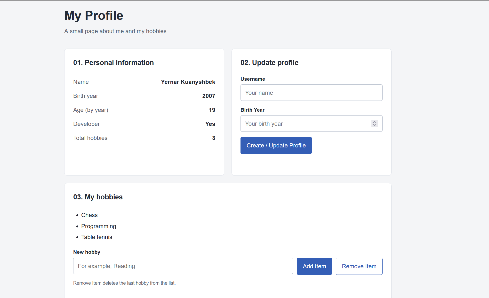
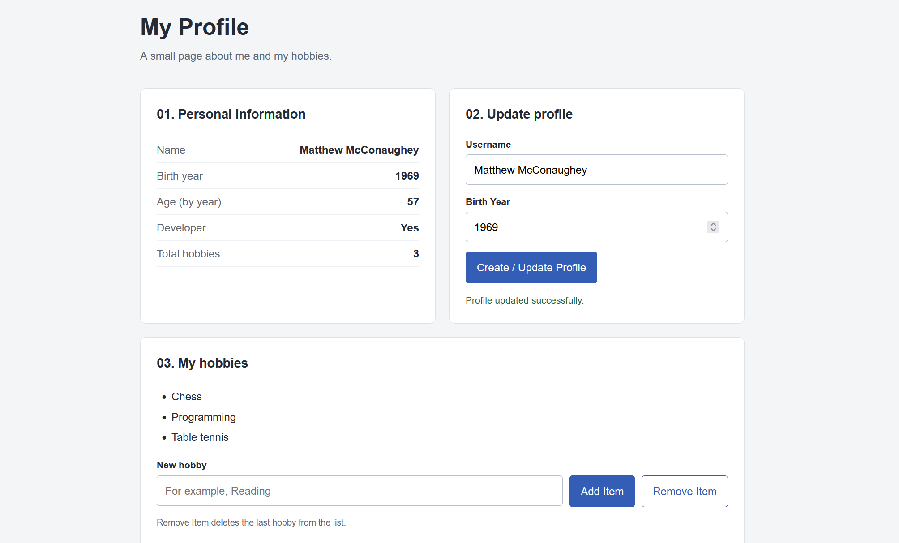
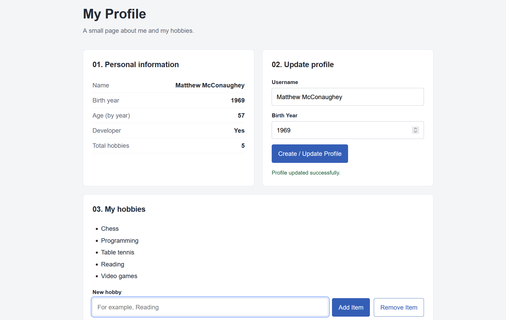
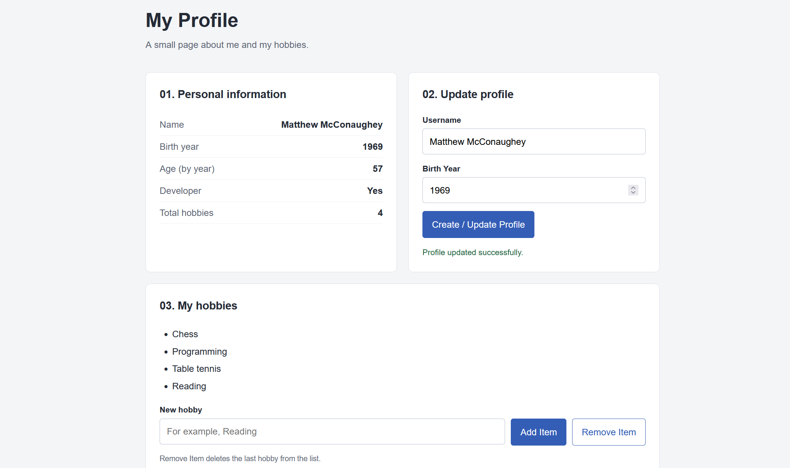

# Assignment 5 — JavaScript Basics

**Name:** Yernar Kuanyshbek
**Group:** SE-2539

This project is a small personal profile page. It uses HTML, CSS and JavaScript. The user can update their name and birth year, add hobbies and remove the last hobby.

## Part 1 — Profile Object, Data Types & Arithmetic

### Task 1 — The Personal Info Object

The userProfile object is declared with const in script.js. It contains a string (name), a number (birthYear), a boolean (isDeveloper) and an array (hobbies). The page displays these values. const prevents reassignment of the object variable, but its properties can still be updated.

### Task 2 — Arithmetic Calculations

The current year comes from new Date().getFullYear(). The age is calculated by subtracting birthYear from the current year. This is age by calendar year because the form does not ask for a full date of birth. The second metric is userProfile.hobbies.length, which counts the hobbies. Both values appear on the page and in the browser console.

## Part 2 — Form Input & Event Responses

### Task 3 — HTML Form Setup

The profile form contains a Username input, a Birth Year input and a Create / Update Profile button. The fields are required. The birth year must be a whole number between 1900 and the current year.

### Task 4 — Event Listener

A submit event listener reads the inputs. event.preventDefault() stops the form from reloading the page. Number() converts the birth year from text to a number. After validation, the listener updates the object and calls showProfile() to update the DOM.

For this check, the name was changed to Arsen and the birth year to 2007. The screenshot shows age 19 in 2026 and the success message. These are test values.

## Part 3 — DOM List Manipulation

### Task 5 — Creating & Removing Elements

The hobbies are displayed inside a <ul>. Add Item reads the hobby input, adds it to the array with push(), creates a new <li> with document.createElement() and inserts it with appendChild(). The text is assigned with textContent.

The screenshot shows Reading added as the fourth hobby. The counter changes to 4.

Remove Item uses pop() to remove the last array value and lastElementChild.remove() to remove the last list element. The counter is updated too. When the list is empty, the remove button is disabled.

The screenshot shows Reading removed and the counter back at 3.

## Work process summary

The HTML defines the profile area, two forms and the hobby list. CSS adds spacing, colors and a layout that stacks the sections on smaller screens. JavaScript connects the page to the profile object and handles the form and button events. The browser checks covered updating the profile, adding a hobby, removing the last hobby, emptying the list and adding an item to an empty list.

Changes are stored in memory only. Reloading the page restores the initial profile. No database or libraries are needed.

